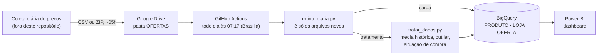

# Pipeline Analítico para Recomendação de Compras

Repositório do banco de dados e do pipeline de dados do TCC **"Pipeline Analítico para Recomendação de Compras"**, do curso de Engenharia da Computação da Universidade São Judas Tadeu (USJT).

O projeto coleta diariamente os preços de produtos de hardware em lojas virtuais, armazena o histórico em um Data Warehouse no **Google BigQuery** e classifica cada oferta como *Boa compra*, *Preço médio* ou *Evitar* em relação ao histórico do produto. O resultado é consumido em um dashboard no **Power BI**.

- **Integrantes:** _(preencher com os nomes do grupo)_
- **Orientador(a):** _(preencher)_

---

## Visão geral da arquitetura



1. **Coleta.** Os arquivos de preços (CSV ou ZIP) chegam por volta das 05h em uma pasta do Google Drive. O coletor não faz parte deste repositório.
2. **Carga automática.** Todo dia às 07:17 (horário de Brasília), um fluxo do GitHub Actions executa `rotina_diaria.py`. A rotina lista a pasta do Drive, identifica quais arquivos ainda não foram processados e carrega apenas os novos no BigQuery.
3. **Tratamento.** Depois da carga, `tratar_dados.py` recalcula marca, nomes de loja, média histórica, outlier e situação de compra de cada oferta.
4. **Consumo.** O Power BI se conecta às tabelas do BigQuery. A atualização do relatório é feita manualmente.

## Estrutura do repositório

```
.
├── README.md                    Este arquivo
├── rotina_diaria.py             Orquestrador: lê o Drive (ou pasta local), carrega e trata
├── carregar_dados.py            Leitura dos arquivos, padronização e carga em PRODUTO/LOJA/OFERTA
├── tratar_dados.py              Cálculo da média histórica, outlier e situação de compra
├── requirements.txt             Dependências Python
├── rodar_rotina_diaria.bat      Alternativa para rodar no Windows (Agendador de Tarefas)
├── .github/workflows/
│   └── rotina_diaria.yml        Agendamento diário no GitHub Actions
├── docs/
│   └── banco_de_dados.md        Modelo de dados, diagrama e dicionário de dados
├── sql/
│   ├── criar_tabelas.sql        Criação das tabelas no BigQuery
│   └── consultas_exemplo.sql    Consultas de conferência e de análise
└── dados_exemplo/
    └── amostra_ofertas.csv      Amostra de 36 ofertas no formato de entrada do pipeline
```

## O banco de dados

O Data Warehouse fica no projeto `tcc-engenharia-computacao`, dataset `banco_dados_final`, e segue um **modelo estrela** com uma tabela fato e duas dimensões:

| Tabela | Tipo | O que guarda |
|---|---|---|
| `PRODUTO` | Dimensão | Um registro por produto: nome, categoria e marca |
| `LOJA` | Dimensão | Um registro por loja, com o nome padronizado |
| `OFERTA` | Fato | Uma linha por produto, por loja, a cada coleta, com preço e classificação |
| `CONTROLE_CARGA` | Controle | Registro de cada arquivo já processado, usado para não carregar duas vezes |

O diagrama, o dicionário de dados (campo a campo) e as regras de tratamento estão em **[docs/banco_de_dados.md](docs/banco_de_dados.md)**. O script de criação das tabelas está em **[sql/criar_tabelas.sql](sql/criar_tabelas.sql)**.

## Como a carga funciona

- **Somente arquivos novos.** Cada arquivo do Drive é identificado pelo seu ID e pelo seu conteúdo (hash MD5). Arquivos já registrados em `CONTROLE_CARGA` são pulados. O nome do arquivo não importa.
- **Sem duplicatas.** Mesmo que um arquivo seja carregado de novo, a rotina só insere ofertas que ainda não existem, comparando produto, loja e data de coleta.
- **ZIP e CSV.** Arquivos ZIP são abertos e os CSVs de dentro são lidos. CSV com separador `;` ou `,` é aceito.
- **Primeira execução.** Na primeira vez, a rotina carrega todo o histórico que já estiver na pasta, do mais antigo ao mais novo.
- **Falha isolada.** Se um arquivo falhar, os demais continuam e o problema fica registrado no log e em `CONTROLE_CARGA`.

### Formato do arquivo de entrada

Colunas obrigatórias (veja `dados_exemplo/amostra_ofertas.csv`):

`id_produto_externo; nome_produto; categoria_produto; preco; nome_loja; url_oferta; data_coleta`

## Tratamento dos dados

Para cada oferta, o tratamento considera **somente coletas anteriores** do mesmo produto, nunca as futuras, para evitar viés de antecipação:

- **Média histórica:** média dos preços anteriores do produto, sem contar os que foram marcados como outlier.
- **Outlier:** o preço está mais de 30% acima ou abaixo da média histórica.
- **Situação de compra:** *Boa compra* (até 10% abaixo da média), *Preço médio* (dentro de ±10%), *Evitar* (mais de 10% acima) ou *Sem histórico* (primeira coleta do produto).

Um exemplo calculado passo a passo está em [docs/banco_de_dados.md](docs/banco_de_dados.md#exemplo-de-tratamento).

## Como reproduzir

**Pré-requisitos:** Python 3.12, uma conta no Google Cloud com um projeto e um dataset no BigQuery, e o [Google Cloud CLI](https://cloud.google.com/sdk/docs/install).

```bash
# 1. Instalar as dependências
pip install -r requirements.txt

# 2. Autenticar no Google Cloud (credenciais da própria conta, sem chave JSON)
gcloud auth application-default login
gcloud config set project SEU_PROJETO
```

3. Ajuste `PROJECT_ID` e `DATASET_ID` no início de `carregar_dados.py` e `tratar_dados.py` para o seu projeto e dataset.
4. (Opcional) Crie as tabelas com `sql/criar_tabelas.sql`. Se pular este passo, o pipeline as cria sozinho na primeira carga.
5. Rode primeiro em modo simulação, que lista o que seria carregado sem gravar nada:

```bash
python rotina_diaria.py --origem local --pasta dados_exemplo --simular
```

6. Para carregar de verdade, rode o mesmo comando sem `--simular`:

```bash
python rotina_diaria.py --origem local --pasta dados_exemplo
```

Opções úteis de `rotina_diaria.py`:

| Opção | Efeito |
|---|---|
| `--origem drive` ou `local` | De onde ler os arquivos (pasta do Google Drive ou pasta no computador) |
| `--pasta CAMINHO` | Pasta local de entrada (com `--origem local`) |
| `--pasta-id ID` | ID da pasta do Google Drive (ou variável de ambiente `DRIVE_FOLDER_ID`) |
| `--simular` | Não baixa nem grava nada, só lista o que seria feito |
| `--limite N` | Processa no máximo N arquivos (do mais antigo para o mais novo) |
| `--sem-tratamento` | Faz a carga sem rodar o tratamento no final |

## Automação (GitHub Actions)

O arquivo [`.github/workflows/rotina_diaria.yml`](.github/workflows/rotina_diaria.yml) agenda a execução diária e também permite rodar manualmente (aba **Actions** → *Run workflow*, com a opção de simular).

- **Autenticação sem chave.** O GitHub se identifica no Google Cloud por *Workload Identity Federation*. Não há arquivo de credencial no repositório.
- **Segredo.** O ID da pasta do Drive fica no cofre de segredos do GitHub (`DRIVE_FOLDER_ID`), fora do código.
- **Conta de serviço dedicada.** A rotina usa uma conta própria, com papéis do BigQuery (editor de dados e usuário de jobs) e acesso de leitura somente à pasta de coletas do Drive.

## Limitações conhecidas

- O projeto usa o BigQuery em modo **Sandbox** (sem faturamento), que **não permite `UPDATE` nem `MERGE`**. Por isso o tratamento lê a tabela inteira, recalcula em Python e regrava a tabela (`WRITE_TRUNCATE`).
- No Sandbox, tabelas e partições **expiram em 60 dias**. A rotina registra um aviso no log quando detecta essa expiração. Ativar o faturamento do projeto permite remover o limite.
- As chaves primárias e estrangeiras do BigQuery são apenas informativas: a integridade é garantida pelos scripts de carga.
- A identificação de marca usa palavras-chave no nome do produto. Produtos de marcas fora da lista ficam com a marca vazia.
- A atualização do Power BI não é automática.
