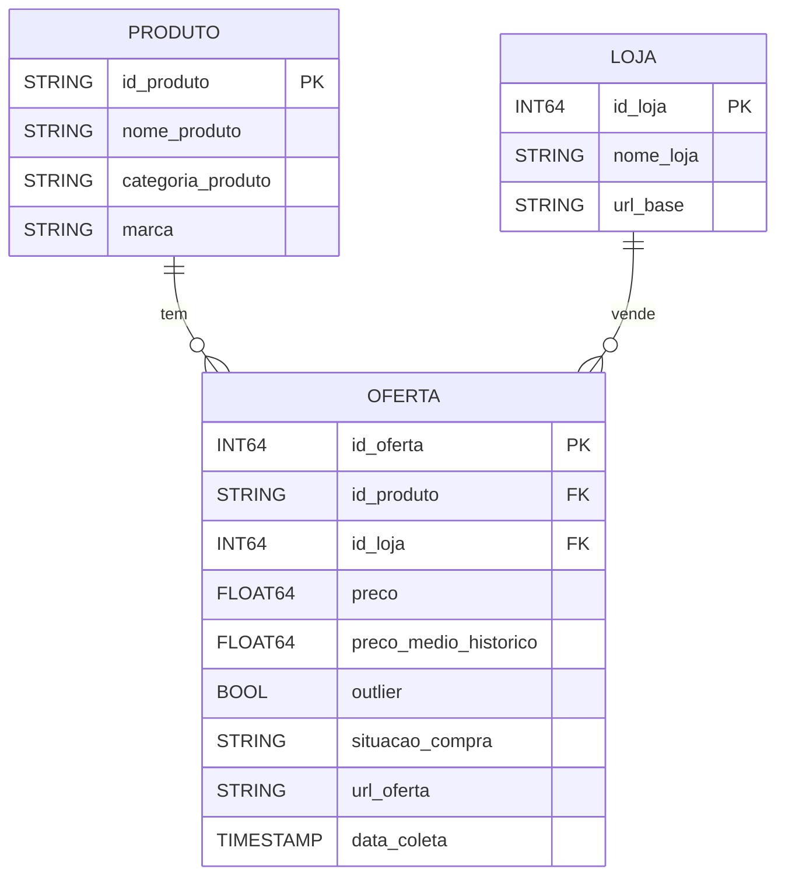

# Documentação do banco de dados

Este documento descreve o Data Warehouse do projeto no **Google BigQuery**: o modelo de dados, o dicionário de dados (campo a campo) e as regras aplicadas pelo pipeline.

- **Projeto:** `tcc-engenharia-computacao`
- **Dataset:** `banco_dados_final`
- **Modelo:** estrela (*star schema*), com uma tabela fato (`OFERTA`) e duas dimensões (`PRODUTO` e `LOJA`)
- **Tabela de apoio:** `CONTROLE_CARGA`, criada pela rotina diária para registrar os arquivos já processados

## Índice

1. [Modelo de dados](#modelo-de-dados)
2. [Dicionário de dados](#dicionário-de-dados)
3. [Particionamento e clusterização](#particionamento-e-clusterização)
4. [Regras de integridade](#regras-de-integridade)
5. [Regras de tratamento](#regras-de-tratamento)
6. [Exemplo de tratamento](#exemplo-de-tratamento)
7. [Como o Power BI usa o banco](#como-o-power-bi-usa-o-banco)
8. [Limitações](#limitações)
9. [Conferir o esquema real no BigQuery](#conferir-o-esquema-real-no-bigquery)

---

## Modelo de dados



Cada linha de `OFERTA` representa o preço de **um produto**, em **uma loja**, em **um momento de coleta**. O produto e a loja são descritos nas tabelas de dimensão, e a oferta aponta para elas pelos campos `id_produto` e `id_loja`.

**Por que esse formato e não uma tabela única?** Se produto, loja e preço ficassem juntos, o nome, a categoria e a marca se repetiriam a cada nova coleta, o que deixa a base maior e mais sujeita a inconsistências. Separando em fato e dimensões, cada informação é registrada uma única vez e referenciada por identificador.

---

## Dicionário de dados

### Tabela `PRODUTO` (dimensão)

Um registro por produto. O catálogo de cada loja identifica os produtos de um jeito diferente (número, código alfanumérico ou texto), por isso o identificador é do tipo texto.

| Campo | Tipo | Descrição | Como é preenchido |
|---|---|---|---|
| `id_produto` | STRING | Identificador do produto no catálogo da loja. Exemplos: `727508` (KaBuM!), `B09729YMPT` (Amazon), `27175` (Terabyte) e um texto com o nome do produto na URL (Pichau). **Chave primária.** | Vem da coluna `id_produto_externo` do arquivo de coleta |
| `nome_produto` | STRING | Nome comercial do produto, como aparece na loja | Arquivo de coleta |
| `categoria_produto` | STRING | Categoria do produto. Valores atuais: Armazenamento, Audio, Fontes, Memórias Ram, Mouses, Placas Mãe, Placas de vídeo, Processadores e Teclados | Arquivo de coleta |
| `marca` | STRING | Fabricante do produto, identificada pelo nome (ex.: ASUS, MSI, Redragon). Fica vazia quando nenhuma marca da lista é reconhecida | Calculada em `tratar_dados.py` |

### Tabela `LOJA` (dimensão)

Centraliza o nome das lojas para que variações de escrita (por exemplo, "kabum" e "KaBuM!") não sejam contadas como lojas diferentes.

| Campo | Tipo | Descrição | Como é preenchido |
|---|---|---|---|
| `id_loja` | INT64 | Identificador numérico da loja. **Chave primária.** | Sequencial, atribuído na primeira vez que a loja aparece |
| `nome_loja` | STRING | Nome padronizado da loja. Valores atuais: KaBuM!, Amazon, Pichau e Terabyte | Arquivo de coleta, padronizado pelo mapa de lojas |
| `url_base` | STRING | Endereço principal da loja. Reservado para uso futuro: o pipeline ainda não preenche este campo | Vazio |

### Tabela `OFERTA` (fato)

Tabela principal: uma linha por produto, por loja, a cada coleta.

| Campo | Tipo | Descrição | Como é preenchido |
|---|---|---|---|
| `id_oferta` | INT64 | Identificador único da oferta. **Chave primária.** | Sequencial, continua a partir do maior valor já existente |
| `id_produto` | STRING | Produto da oferta. **Chave estrangeira** para `PRODUTO.id_produto` | Arquivo de coleta |
| `id_loja` | INT64 | Loja da oferta. **Chave estrangeira** para `LOJA.id_loja` | Obtido a partir do nome da loja padronizado |
| `preco` | FLOAT64 | Preço do produto, em reais, no momento da coleta | Arquivo de coleta |
| `preco_medio_historico` | FLOAT64 | Média dos preços anteriores do produto (veja as regras abaixo). Vazio na primeira coleta de cada produto | Calculado em `tratar_dados.py` |
| `outlier` | BOOL | `TRUE` quando o preço foge mais de 30% da média histórica | Calculado em `tratar_dados.py` |
| `situacao_compra` | STRING | Classificação da oferta: `Boa compra`, `Preço médio`, `Evitar` ou `Sem histórico` | Calculada em `tratar_dados.py` |
| `url_oferta` | STRING | Link direto para o produto na loja | Arquivo de coleta |
| `data_coleta` | TIMESTAMP | Data e hora em que o preço foi coletado. Campo de particionamento | Arquivo de coleta |

### Tabela `CONTROLE_CARGA` (apoio)

Criada automaticamente pela rotina diária. Guarda uma linha por arquivo processado, o que permite carregar somente arquivos novos e consultar o histórico das cargas.

| Campo | Tipo | Descrição |
|---|---|---|
| `arquivo_id` | Texto | Identificador do arquivo no Google Drive (ou caminho, na execução local) |
| `arquivo_nome` | Texto | Nome do arquivo |
| `arquivo_md5` | Texto | Hash do conteúdo do arquivo. Junto com o `arquivo_id`, identifica a versão exata do arquivo |
| `arquivo_tamanho` | Inteiro | Tamanho do arquivo, em bytes |
| `arquivo_modificado_em` | Data/hora | Data da última modificação do arquivo na origem |
| `origem` | Texto | `drive` ou `local` |
| `status` | Texto | Resultado do processamento (por exemplo, `carregado`) |
| `linhas_lidas` | Inteiro | Quantidade de linhas lidas do arquivo |
| `ofertas_inseridas` | Inteiro | Quantidade de ofertas realmente inseridas (ofertas que já existiam não são repetidas) |
| `detalhe` | Texto | Mensagem de apoio, como o motivo de uma falha |
| `processado_em` | Data/hora | Momento em que o arquivo foi processado (UTC) |

---

## Particionamento e clusterização

A tabela `OFERTA` é a que mais cresce, então é otimizada para consultas por período e por produto:

- **Particionada por dia** pelo campo `data_coleta`. Consultas que filtram por data leem apenas as partições necessárias.
- **Clusterizada** por `id_produto` e `id_loja`, que são os filtros mais usados no dashboard.

---

## Regras de integridade

O BigQuery não impõe chaves primárias e estrangeiras (elas são apenas informativas). A integridade é garantida pelos scripts de carga:

- **Sem produtos repetidos.** Antes de inserir, `carregar_dados.py` consulta `PRODUTO` e insere só os produtos que ainda não existem.
- **Sem lojas repetidas.** O nome da loja é padronizado antes de buscar ou criar o `id_loja`.
- **Sem ofertas repetidas.** A rotina diária considera uma oferta já existente quando o conjunto (`id_produto`, `id_loja`, `data_coleta`) já está na tabela, e não a insere de novo. Dentro de um mesmo arquivo, coletas repetidas do mesmo produto na mesma loja no mesmo dia também são eliminadas.
- **Sem arquivos repetidos.** Cada arquivo processado é registrado em `CONTROLE_CARGA`.

---

## Regras de tratamento

O tratamento é feito por `tratar_dados.py` e é **idempotente**: pode ser executado quantas vezes for necessário, porque recalcula tudo a partir dos dados atuais.

### Padronização de loja

Variações de escrita são convertidas para o nome oficial:

| Entrada (sem diferenciar maiúsculas) | Nome padronizado |
|---|---|
| `kabum`, `kabum!` | KaBuM! |
| `pichau` | Pichau |
| `terabyte` | Terabyte |
| `amazon` | Amazon |

Nomes que não estão no mapa recebem apenas a formatação de título (primeira letra maiúscula).

### Identificação de marca

A marca é buscada no nome do produto, por palavra-chave: Redragon, ASUS, Gigabyte, MSI, NVIDIA, AMD, Intel, Corsair, Kingston e Galax. Se nenhuma for encontrada, o campo fica vazio.

### Média histórica, outlier e situação de compra

As ofertas de cada produto são percorridas em ordem de data. Para cada oferta, usa-se **somente o que aconteceu antes dela**, nunca coletas futuras, o que evita viés de antecipação (*look-ahead bias*).

| Etapa | Regra |
|---|---|
| Média histórica | Média dos preços anteriores do produto, sem contar os preços que já foram marcados como outlier |
| Outlier | `abs(preço − média) / média > 0,30` (variação de mais de 30% em relação à média) |
| Boa compra | `preço / média ≤ 0,90` (10% ou mais abaixo da média) |
| Preço médio | `0,90 < preço / média ≤ 1,10` |
| Evitar | `preço / média > 1,10` (mais de 10% acima da média) |
| Sem histórico | Primeira coleta do produto (ainda não existe média) |

Um preço marcado como outlier **não entra** na média que serve de referência para as coletas seguintes, para que um erro de preço isolado não distorça a série.

> A média é calculada por **produto**, considerando as coletas de todas as lojas em que ele aparece.

### Exemplo de tratamento

Série ilustrativa de um produto (preços fictícios, calculados pela própria função `calcular_tratamento` do repositório):

| Data | Preço (R$) | Média histórica (R$) | Outlier | Situação | Por quê |
|---|---|---|---|---|---|
| 15/10 | 1.000 | — | Não | Sem histórico | Primeira coleta |
| 16/10 | 1.020 | 1.000,00 | Não | Preço médio | +2% sobre a média |
| 17/10 | 980 | 1.010,00 | Não | Preço médio | −3% |
| 18/10 | 1.010 | 1.000,00 | Não | Preço médio | +1% |
| 19/10 | 1.600 | 1.002,50 | **Sim** | Evitar | +60%, acima do limite de 30% |
| 20/10 | 900 | 1.002,50 | Não | Boa compra | −10%. O preço de 19/10 não entrou na média |
| 21/10 | 1.200 | 982,00 | Não | Evitar | +22% (acima de 10%, mas abaixo do limite de outlier) |
| 22/10 | 1.005 | 1.018,33 | Não | Preço médio | −1% |

---

## Como o Power BI usa o banco

O Power BI se conecta diretamente às tabelas `PRODUTO`, `LOJA` e `OFERTA` do dataset `banco_dados_final`, relacionando-as pelos campos `id_produto` e `id_loja`. Com isso, o dashboard monta o histórico de preços de cada produto, a comparação entre lojas e as marcações de situação de compra, além de filtros por categoria, marca e período. A atualização do relatório é manual e deve ser feita depois que a carga diária terminou.

---

## Limitações

- **Sem `UPDATE`/`MERGE`.** O BigQuery em modo Sandbox não permite essas operações, então o tratamento regrava as tabelas inteiras (`WRITE_TRUNCATE`).
- **Expiração de 60 dias.** No Sandbox, tabelas e partições expiram em 60 dias. Ativar o faturamento do projeto permite remover esse limite.
- **Chaves não impostas.** As chaves primárias e estrangeiras são apenas documentação.
- **Marca por palavra-chave.** Produtos de marcas que não estão na lista ficam sem marca.
- **`url_base` vazia.** O campo existe, mas ainda não é preenchido.

---

## Conferir o esquema real no BigQuery

Para comparar este documento com o que existe de fato no BigQuery, rode a consulta abaixo no console:

```sql
SELECT table_name, ordinal_position, column_name, data_type, is_nullable
FROM `tcc-engenharia-computacao.banco_dados_final.INFORMATION_SCHEMA.COLUMNS`
ORDER BY table_name, ordinal_position;
```
